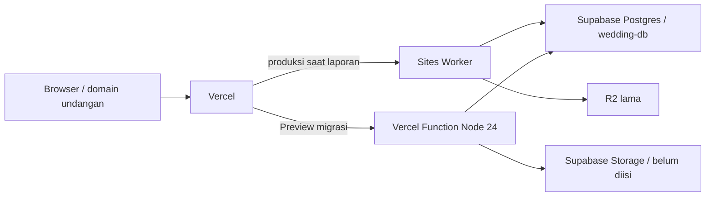

# Laporan migrasi — 30 Oktober 2026

Snapshot laporan awal. Untuk penyelesaian blocker dan bukti terbaru, lihat [gerbang release](release-gates-2026-10-30.md) dan status deployment pada PR #3.

## A. Root cause

Produksi masih meneruskan sembilan kelompok rute ke backend Sites. Perbaikan redirect pada PR #2 mempertahankan ketergantungan tersebut sehingga WAF upstream masih dapat memblokir tamu. PR #3 mengganti seluruh rewrite dengan fungsi Vercel lokal dan adapter Supabase Storage. Tidak ada proxy/fallback ke host lama dalam runtime baru. **Kode baru belum dipromosikan ke produksi** karena konfigurasi backend dan akses media sumber belum tersedia.

## B. Arsitektur

GitHub menyimpan kode. Proyek, domain, database, ID, slug, dan token undangan tidak diganti. Sumber lama dipertahankan untuk rollback.

## C. Implementasi

| Berkas/kelompok | Perubahan |
|---|---|
| `api/backend.js`, `server/vercel.js` | Adapter Web Request/Response, metadata IP/negara tepercaya, environment terbatas, penolakan header identitas palsu, semua metode HTTP |
| `server/storage.js`, `worker/uploads.js` | Storage private, upload staging bertiket, validasi pemilik/TTL/format/ukuran, finalisasi idempotent, bukti hadiah privat |
| `worker/index.js` | Integrasi upload baru, CSP terbatas, proteksi HTML admin, logika bisnis lama digunakan kembali |
| `vercel.json` | Sembilan rewrite internal; HTML privat hanya dibundel bersama fungsi |
| `scripts/build.mjs`, `scripts/dev.mjs` | Pisahkan `dist/client` dan `dist/server-assets`, hilangkan output deployment Sites/D1 dan simulasi login Sites |
| `public/upload.js`, `public/admin.js`, dua HTML pemuat script | CMS memakai signed upload untuk foto hingga 8 MB, tanpa perubahan desain |
| `scripts/migrate-media.mjs` | Inventory penuh R2, copy tanpa menghapus sumber, checksum/byte/Content-Type, arsip private objek di luar pola aplikasi |
| `scripts/verify-backup.mjs`, `scripts/check-release.mjs` | Verifikasi backup dan restore terisolasi; gerbang release gagal tertutup saat syarat belum lengkap |
| `tests/`, `playwright.config.mjs` | Regresi adapter, upload, backup, browser desktop dan emulasi mobile |
| `package.json`, lockfile, `.github/workflows/migration-checks.yml` | Node 24, dependency terpin, CI build/test/audit/browser tanpa secret produksi |
| `.env.example`, README, `docs/` | Nama konfigurasi, dampak sesi, prosedur migrasi dan rollback; metadata lama diarsipkan di luar runtime |

Tidak ada migrasi skema produksi, rotasi token tamu, atau perubahan RLS selama pekerjaan ini.

## D. Integritas data

Snapshot atomik privat diambil pada `2026-10-30T07:37:15.910Z`. Seluruh 15 tabel memiliki checksum yang diverifikasi; 14 tabel aplikasi (754 baris) berhasil direstore ke SQLite in-memory dengan foreign key aktif. Ini verifikasi pemulihan data aplikasi terisolasi, bukan bukti restore PostgreSQL hosted. Backup tidak masuk Git atau artefak CI.

| Entitas | Snapshot | Pemeriksaan terakhir setelah pekerjaan |
|---|---:|---:|
| Undangan | 150 | 150 |
| RSVP | 37 | 37 |
| Hadiah | 5 | 5 |
| Pesan | 10 | 10 |
| Settings | 2 | 2 |
| Referensi media unik DB | 21 | Tidak diubah |
| Objek R2 total | Belum diketahui | Belum diketahui |
| Media tersalin/terverifikasi | 0 | 0 |

Perbandingan ID, slug dan access token undangan dengan snapshot tidak menemukan perubahan. Lima record hadiah tidak mempunyai `proof_key` non-null pada baseline; hal ini tidak membuktikan bucket sumber tidak memiliki objek bukti lama. Tabel aktivitas dapat berubah karena kunjungan nyata, sehingga snapshot baru wajib diambil sebelum cutover.

## E. Matriks verifikasi

PASS lokal berarti pengujian terisolasi, memakai SQL allowlist dan fixture in-memory; bukan acceptance database/Storage hosted. NOT VERIFIED berarti belum dijalankan atau belum dapat dibuktikan. Preview dilindungi autentikasi Vercel; proteksi tersebut tidak dinonaktifkan.

| Persyaratan | Lokal/CI | Preview dengan layanan asli | Produksi hasil migrasi |
|---|---|---|---|
| Landing publik dan splash | PASS browser | PASS HTTP landing | NOT VERIFIED |
| Undangan personal, token exchange, nama dan event sesuai | PASS integrasi/browser | NOT VERIFIED — DB 503 | NOT VERIFIED |
| RSVP kirim, retry tanpa duplikat, ubah dan persist | PASS integrasi/browser | NOT VERIFIED | NOT VERIFIED |
| Popup hadir/tidak hadir dan mood halaman | PASS browser | NOT VERIFIED | NOT VERIFIED |
| Guestbook, nama otomatis, pagination, original bahasa dan moderasi | PASS pengujian fixture | NOT VERIFIED — DB/OpenAI belum tersedia | NOT VERIFIED |
| Gallery dan lightbox | PASS browser fixture | NOT VERIFIED — Storage belum tersedia | NOT VERIFIED |
| Maps dan kalender | NOT VERIFIED klik ujung-ke-ujung | NOT VERIFIED | NOT VERIFIED |
| Konten Indonesia/Inggris dan metadata lokasi | PASS fixture/browser | PASS endpoint locale; geo lintas negara NOT VERIFIED | NOT VERIFIED |
| Layout desktop dan viewport mobile/touch | PASS Chrome/emulasi | NOT VERIFIED dengan data asli | NOT VERIFIED |
| Android/iOS fisik, Instagram/WhatsApp, jaringan terdampak | NOT VERIFIED | NOT VERIFIED | NOT VERIFIED |
| Login/logout admin melalui UI | PASS browser | PASS halaman login dan redirect logout; autentikasi asli NOT VERIFIED | NOT VERIFIED |
| Tolak admin anonim, header palsu dan HTML admin langsung | PASS integrasi | PASS 401 API dan 404 shell | NOT VERIFIED |
| Buat/edit/nonaktif/hapus undangan, slug/link personal | PASS pengujian terisolasi | NOT VERIFIED | NOT VERIFIED |
| Bulk upload, kapasitas meja, jumlah tamu/RSVP dashboard | PASS pengujian terisolasi | NOT VERIFIED | NOT VERIFIED |
| Simpan event, konten bilingual dan foto CMS | PASS pengujian terisolasi | NOT VERIFIED | NOT VERIFIED |
| Upload besar, format palsu, tiket silang/tampered, finalisasi retry | PASS storage simulasi | NOT VERIFIED | NOT VERIFIED |
| Bukti hadiah hanya admin | PASS integrasi/storage simulasi | NOT VERIFIED | NOT VERIFIED |
| Wedding Desk, check-in, seating, souvenir, agenda multiundangan | PASS pengujian terisolasi/browser navigasi | NOT VERIFIED | NOT VERIFIED |
| Gift click/copy, hati, scroll analytics | PASS pengujian terisolasi | NOT VERIFIED | NOT VERIFIED |
| Cookie, CSRF, rate limit, privasi cache/media, CSP | PASS pengujian terisolasi | PASS no-store/penolakan anonim; alur authenticated NOT VERIFIED | NOT VERIFIED |
| Tidak ada rewrite/fallback runtime ke host lama | PASS source/build/regresi | PASS rute/redirect yang diuji | NOT VERIFIED — versi lama masih produksi |
| Database lama, SQL allowlist, integritas ID/token | PASS read-only baseline dan pengujian adapter | NOT VERIFIED adapter ke DB asli | NOT VERIFIED cutover |
| Backup checksum dan restore aplikasi terisolasi | PASS | Tidak memerlukan Preview | Restore PostgreSQL hosted NOT VERIFIED |
| RLS tetap, tidak ada reset DB | PASS audit/read-only; tidak ada mutasi skema | Tidak diubah | Tidak diubah |
| Inventory semua R2 dan copy/checksum ke Storage private | NOT VERIFIED — akses sumber belum tersedia | NOT VERIFIED | NOT VERIFIED |
| Semua secret backend Vercel terkonfigurasi | NOT VERIFIED — daftar environment kosong | NOT VERIFIED | NOT VERIFIED |
| Build, 85 tes Node, 6 perjalanan Playwright | PASS lokal dan CI | Deployment READY | NOT VERIFIED cutover |
| Audit dependency runtime | PASS — 0 kerentanan runtime | — | — |
| Smoke test produksi baru dan tidak ada WAF block pada perangkat terdampak | NOT VERIFIED | NOT VERIFIED | NOT VERIFIED |

Terdapat 12 probe Preview yang sesuai ekspektasi routing/security: landing dan locale 200, canonical slug 308, dua halaman login 200, shell 404, API admin anonim 401, API unknown 404, logout 303. Tiga probe database/media menghasilkan **503 karena belum dikonfigurasi**. Respons 503 bukan PASS fitur.

## F. Bukti deployment dan blocker

- Branch: `codex/migrate-vercel-supabase`.
- Commit implementasi: `7254196d92cb7379638cc35d0fc4a45f9ed4d257`.
- [Draft PR #3](https://github.com/slaks37/stefen-jessica-wedding/pull/3), belum merge.
- [Preview](https://stefen-jessica-wedding-git-codex-migra-b0ea20-slaks37s-projects.vercel.app) dan [deployment implementasi](https://vercel.com/slaks37s-projects/stefen-jessica-wedding/2Xwg7aPZV69mEBerRgmoFxrJqPKL).
- [CI implementasi PASS](https://github.com/slaks37/stefen-jessica-wedding/actions/runs/41022938520/job/123954267475).
- Produksi tetap deployment `dpl_53hrbJUg2PbvQ9iu9jWwV9pGVqBZ`, commit `675ad9d3296172e382841f7e883ef6b0c896d3df`, READY pada pemeriksaan terakhir. Ini **bukan** deployment migrasi.

Pemilik telah menyatakan dapat menyiapkan akses, tetapi environment proyek masih kosong pada pemeriksaan terakhir. Masukkan tujuh nama server pada dokumen migrasi ke Preview proyek yang sama. Siapkan kredensial List/Get bucket R2 asli secara privat untuk proses inventory/copy. Jangan kirim secret ke chat. Setelah tersedia: verifikasi koneksi DB dan sesi, migrasi/validasi semua objek, acceptance Preview dengan fixture terpisah, snapshot baru, rollback, lalu pengujian perangkat terdampak sebelum merge/cutover.

Catatan operasional: uji CLI environment salah menafsirkan perintah dan membuat proyek sementara `check-release`. Proyek itu sudah dihapus (GET 404), tautan lokalnya dibersihkan, dan produksi utama terkonfirmasi tetap pada commit lama. Jalur CLI itu dilarang digunakan ulang dalam panduan. Tidak ada klaim verifikasi privasi artefak deployment sementara di luar pembersihan yang telah dibuktikan.

## G. Final release assessment

**BLOCKED**

Implementasi, tes lokal/CI, backup dan deployment Preview sudah tersedia. Gerbang wajib masih gagal karena environment backend kosong, inventory/copy media sumber belum dapat dilakukan, dan acceptance hosted serta perangkat/jaringan terdampak belum terverifikasi. Tidak dilakukan merge, cutover domain, atau penghapusan sumber lama.
