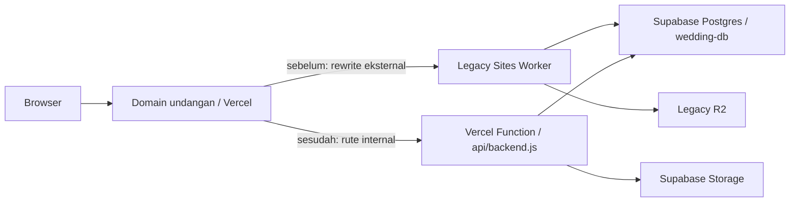

# Migrasi runtime Vercel + Supabase

Status gerbang terbaru: [hosted acceptance, 49 objek media, backup baru dan akses Kamboja](release-gates-2026-10-30.md). Hasil cutover produksi dicatat pada PR #3. Catatan blocker awal di dokumen historis tidak menggantikan bukti terbaru.

Diagnosis awal: [jaringan Kamboja dan evidence](cambodia-access-2026-10-30.md). Seluruh tujuh environment kini telah dikonfigurasi untuk Preview dan Production dengan token server terpisah; tidak ada guest access token yang diputar.

## Arsitektur



Tidak ada fallback ke origin lama pada aplikasi baru. OpenAI untuk moderasi/terjemahan tetap opsional dalam kode dan harus dikonfigurasi saat cutover karena situs lama sudah memakainya.

## Penggantian dependensi

| Sebelumnya | Pengganti |
|---|---|
| Sembilan rewrite eksternal | Rewrite internal `/api/backend?__route=...`; query token tetap utuh |
| Worker hosting | Native Web Request/Response handler Node.js 24 pada proyek Vercel yang sama |
| Header identitas platform | Dihapus pada batas Vercel; admin wajib memakai cookie HMAC yang sah |
| `env.ASSETS` | Adapter pembaca tiga HTML dari `dist/server-assets`; shell admin tidak masuk direktori publik |
| `env.BUCKET` | Adapter Supabase Storage; nama antarmuka dipertahankan untuk menggunakan kembali logika upload/gift |
| D1 produksi | Tidak diteruskan oleh adapter; database selalu `wedding-db` pada proyek Postgres lama |
| R2 produksi | Salinan terverifikasi di Storage; R2 hanya dipakai CLI migrasi, tidak oleh aplikasi |
| `.openai/hosting.json` | Diarsipkan di `docs/legacy/`, tidak dibaca build atau fungsi Vercel |
| Drizzle/D1 deployment output | Dihapus dari build. Migrasi SQLite sumber tetap untuk pengujian/dev terisolasi |

`worker/` berisi logika bisnis yang dipakai kembali sebagai modul JavaScript; Vercel bukan memanggil Worker jarak jauh.

## Environment server

Konfigurasikan pada proyek **stefen-jessica-wedding**, target Preview terlebih dahulu, kemudian Production setelah verifikasi:

- `SUPABASE_URL=https://lgwrwymrjcptoztjvbxz.supabase.co`
- `WEDDING_DB_TOKEN`: token transport server yang hash-nya terdaftar pada `wedding_internal.api_tokens`. Bukan anon key dan bukan token tamu.
- `SUPABASE_STORAGE_KEY`: capability server untuk gateway `wedding-storage`; service-role tetap dalam environment Supabase. Prefix Preview dipaksa ke bucket `wedding-qa-*`. Adapter tetap memahami JWT lama untuk kompatibilitas, tetapi release ini memakai gateway terbatas.
- `ADMIN_EMAIL`, `ADMIN_ACCESS_CODE`: nilai yang sudah ditentukan pemilik. `ADMIN_SESSION_SECRET` baru khusus Vercel karena nilai Sites tidak dapat dibaca ulang; login admin ulang diperlukan saat cutover.
- `OPENAI_API_KEY`: nilai server untuk layanan bahasa yang sudah digunakan.

Nilai secret Sites tidak dapat dibaca ulang melalui konektor. Jangan membuat endpoint publik untuk mengekspornya. Jangan mengisi token placeholder lalu menganggap backend siap.

Guest access token/slug dan guest cookie tetap sama serta host-only. Secret sesi Vercel yang baru memerlukan login admin ulang dan mengubah hash identitas pengunjung anonim; historical activity tetap disimpan. Token transport Sites lama dipertahankan, sedangkan dua token server baru dipisahkan untuk `wedding_preview` dan `public`. Tidak ada rotasi token tamu.

## Backup dan integritas

Snapshot atomik hanya-baca seluruh tabel `public` aplikasi dan `wedding_internal.api_tokens` disimpan pada `.local/backups/production-before-vercel-migration-2026-10-30.json`, mode 0600. Snapshot memuat skema SQL, metadata kolom, jumlah, checksum, dan baris asli. Jangan commit atau unggah file ini ke artefak CI.

Verifikasi:

```sh
node scripts/verify-backup.mjs .local/backups/production-before-vercel-migration-2026-10-30.json
```

Verifier memeriksa checksum seluruh tabel dan memulihkan 14 tabel aplikasi ke SQLite in-memory dengan foreign key aktif. Ini memverifikasi recoverability data aplikasi tanpa menjalankan restore pada produksi. Ambil snapshot baru yang sama konsistennya tepat sebelum cutover; produksi menerima kunjungan nyata sehingga hitungan bukan angka tetap.

Baseline snapshot awal migrasi: 150 undangan, 37 respons RSVP, 5 hadiah, 10 pesan, 2 settings; total 754 baris aplikasi. Kenaikan dibanding insiden sebelumnya merupakan data aktif yang harus dipertahankan.

## Pemindahan media

Perlu kredensial **List/Get bucket R2 asli**: `R2_ACCOUNT_ID`, `R2_BUCKET`, `R2_ACCESS_KEY_ID`, `R2_SECRET_ACCESS_KEY`. Akun Cloudflare terhubung saat audit tidak memiliki bucket tersebut; API daftar R2 mengembalikan 403/10042. Mengaktifkan R2 kosong pada akun lain tidak memberikan akses ke objek lama.

Alternatif yang berhasil digunakan dengan persetujuan pemilik: ekspor dari binding R2 asli `BUCKET` melalui helper read-only sementara pada Sites yang sama. Wajib cookie admin sah dan capability acak sementara; tidak mengekspor secret environment. Helper otomatis kedaluwarsa dan dinonaktifkan setelah migrasi. `node scripts/migrate-media.mjs --sites-source --copy` membaca sesi sumber privat dari `.local/migration/source-session.json` dan menginventarisasi seluruh bucket, bukan hanya referensi CMS.

Gunakan environment proses privat yang diisi melalui pengelola secret yang disetujui, tanpa mencetak nilainya. Jangan menjalankan `vercel env run` pada CLI 65.8.0 dalam workflow ini: pemanggilan pemeriksaan yang diuji justru membuat deployment file sementara, bukan menjalankan perintah lokal. Proyek sementara `check-release` sudah dihapus, hasil GET proyek tersebut 404, dan tautan lokal yang terbentuk sudah dibersihkan. Proyek itu bukan bagian arsitektur migrasi; produksi utama tetap pada commit `675ad9d3296172e382841f7e883ef6b0c896d3df`.

```sh
npm run media:inventory
npm run media:migrate
```

Mode inventory hanya membaca sumber. Mode copy membuat bucket **private**, menyalin semua objek, menolak overwrite jika isi berbeda, lalu membandingkan SHA-256, jumlah byte, Content-Type, dan objek yang direferensikan CMS/gifts. Tidak ada operasi delete/write pada R2. Manifest berada di `.local/migration/media-manifest.json` (privat, diabaikan Git).

| Bucket | Akses aplikasi |
|---|---|
| `wedding-gallery` | Storage private; proxy publik `/media/<uuid>.<ext>` |
| `wedding-private` | Bukti hanya melalui API admin terautentikasi |
| `wedding-staging` | Private; URL upload sementara untuk satu file |
| `wedding-archive` | Private; objek lama di luar pola aplikasi tetap dipertahankan |

Pada baseline ditemukan 21 referensi media unik dalam database, tanpa `proof_key` non-null pada 5 hadiah. **Jumlah objek R2 total belum diketahui**; referensi database tidak menggantikan inventory bucket penuh. Tidak ada objek yang dinyatakan tersalin sebelum manifest terverifikasi.

## Upload 8 MB dan bukti 5 MB

Vercel membatasi request body 4,5 MB. Browser meminta tiket melalui `/api/uploads`, lalu PUT langsung ke objek staging Supabase yang ditandatangani. Finalisasi `/api/uploads/complete` memeriksa pemilik, TTL, ukuran dan signature byte, memindahkan file valid ke bucket akhir, lalu menghapus staging. Pengulangan finalisasi mengembalikan hasil yang sama.

Foto tidak tampil sebelum validasi. Bukti mendapat tiket yang terikat undangan dan hanya diterima pada `/api/invitation/<slug>/gift`; undangan lain tidak bisa memakainya. Endpoint multipart lama tetap mendukung file kecil; klien yang mengunggah file besar harus memakai alur tiket. UI CMS sudah memakai alur baru tanpa perubahan tampilan.

## Validasi dan gerbang release

```sh
npm ci
npm run build
npm test
npm run test:browser
npm audit --omit=dev
npm run release:check
```

`release:check` gagal secara tertutup jika secret, backup, atau manifest media belum memenuhi syarat. Lolosnya skrip ini belum menggantikan verifikasi Preview, perangkat tamu, dan approval/check GitHub yang berlaku.

Playwright memakai database in-memory dan SQL allowlist yang sama melalui adapter Supabase simulasi. Chrome terpasang dipakai di macOS; CI memakai Chromium. Mobile viewport/touch adalah emulasi, bukan perangkat fisik/Samsung/WhatsApp/jaringan seluler nyata. Preview yang belum punya secret mengembalikan 503 untuk operasi database/storage, 401 untuk API admin anonim; ini batas konfigurasi, bukan hasil acceptance PASS.

RLS database lama tidak diubah. Semua bucket bersifat private tanpa kebijakan client publik; service key hanya di server. Build tidak mengandung shell admin publik atau kredensial. Identitas pengunjung mengikuti metadata Vercel yang tepercaya, bukan header Cloudflare buatan pengakses.

## Urutan cutover

1. Verifikasi backup baru, environment, media manifest, dan rollback.
2. Verifikasi Preview terhadap database dan Storage asli, termasuk CRUD fixture khusus, RSVP idempotent, gift privat, CMS dan Wedding Desk; jangan mengubah undangan tamu yang sudah ada.
3. Uji perangkat/jaringan yang mengalami blok. Perbandingan user-agent tidak cukup.
4. Merge PR hanya setelah gerbang wajib lulus; release memakai proyek/domain lama.
5. Smoke test produksi dan bandingkan integritas data, dengan mempertimbangkan aktivitas tamu nyata.
6. Pertahankan sumber R2 dan backend lama selama periode rollback. Jangan otomatis menghapusnya.

Rollback: revert merge migrasi untuk mengembalikan routing versi insiden yang sudah sehat; Sites versi 47 dan objek R2 lama tetap utuh. Jika produksi baru sudah menerima upload, salin upload baru kembali ke tujuan rollback sebelum mengalihkan supaya media baru tidak hilang. Tidak ada reset/skema destruktif database pada migrasi ini.

Laporan status dan matriks acceptance lengkap: [migration-acceptance-2026-10-30.md](migration-acceptance-2026-10-30.md).
